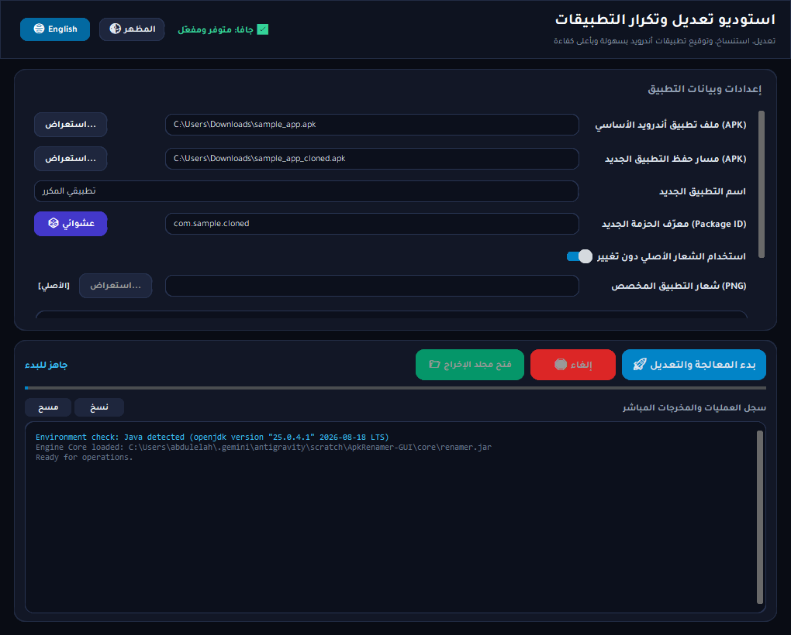
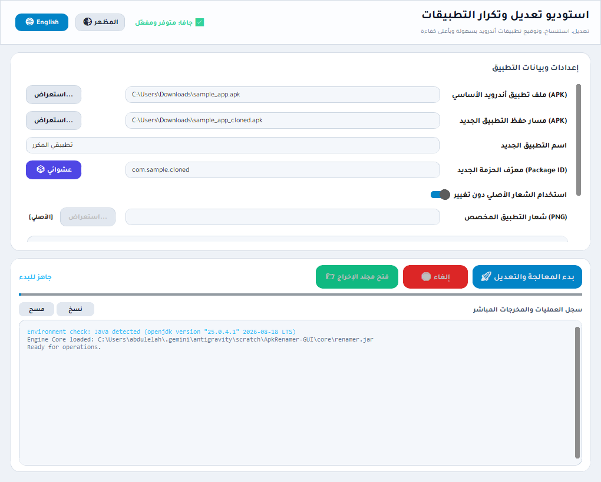
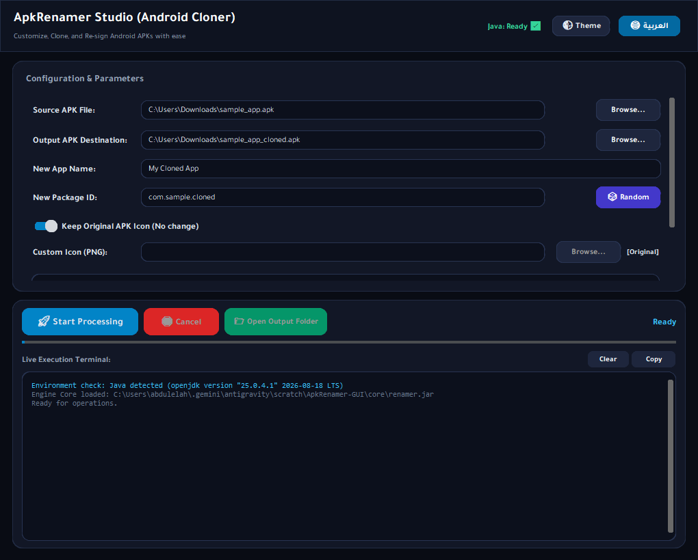

<p align="center">
  <b>English</b> •
  <a href="README.ar.md">العربية</a>
</p>

# ApkRenamer Studio (GUI & CLI)

A modern Android APK customizer, cloner, and renamer. Supports changing app names, package IDs, and app icons with deep renaming for dual/side-by-side installations.

Includes both the original command-line core and the new **Crystal Glass Bilingual GUI** with Google Font **Tajawal**.

---

## 📸 Screenshots (معاينة الواجهة)

### Arabic Interface - Dark Theme (الواجهة العربية - النمط الداكن)


### Light Theme (النمط الفاتح البلوري)


### English Interface - LTR (الواجهة الإنجليزية)


---

## 🌟 New Features in this Fork (GUI Edition)
- **Crystal Glass Interface:** Modern frosted glass design with dark/light themes.
- **Bilingual with Native RTL & LTR:** Toggle between Arabic and English with full right-to-left and left-to-right adaptive layout.
- **Random Package ID Generator (🎲):** Generate valid Android package IDs with one click.
- **Keep Original Icon:** Toggle to keep the original APK icon or provide a new PNG with live preview.
- **Windows Unicode Fix:** Native 8.3 short-path resolution preventing `aapt2` path errors on non-ASCII paths.
- **Standalone One-Click Export:** Compile directly to standalone `.exe` with `build_exe.py`.

---

## 🚀 Running the GUI

### Option 1: Quick Launch (Windows)
Double-click:
```bat
run.bat
```

### Option 2: Python Command
```bash
pip install -r requirements.txt
python main.py
```

### Option 3: Build Standalone Executable (.EXE)
```bash
python build_exe.py
```
Executable will be placed in `dist/ApkRenamerGUI/ApkRenamerGUI.exe`.

---

## 💻 CLI Usage (Original Engine)
```bash
java -jar core/renamer.jar [-a] <path/to/app.apk> [-o] <path/to/renamed.apk> [-n] <new_name> [-p] <new.package.name> [-i] <new_icon.png>
```

- `[-d]`: Deep renaming (search and replace old package in smali to allow side-by-side install).
- `[-t]`: Extract all apk resources to temp folder for manual changes.
- `[-m]`: Skip resource modification.
- `[-da]`: Decode arguments for Apktool (e.g. `-da "--keep-broken-res"`).
- `[-ba]`: Build arguments for Apktool (e.g. `-ba "--use-aapt2"`).
- `[-r] <path/to/dict.txt>`: Dictionary replacement.

---

## 📋 Requirements
- **Java (JRE 8 or newer)** in system PATH.
- **Python 3.8+** (for running from source or building the executable).

---

## 📜 Credits & Third-Party Components
- Original Core: [dvaoru/ApkRenamer](https://github.com/dvaoru/ApkRenamer)
- [Apktool](https://github.com/iBotPeaches/Apktool)
- [Apk Sign](https://github.com/appium/sign)
- [Thumbnailator](https://github.com/coobird/thumbnailator)
- [CustomTkinter](https://github.com/TomSchimansky/CustomTkinter)
- [Tajawal Font](https://fonts.google.com/specimen/Tajawal)

---

<div dir="rtl">

# الدليل العربي (ApkRenamer Studio)

أداة متطورة وعصرية لتعديل، تكرار (استنساخ)، وتوقيع تطبيقات أندرويد (APK). تتيح لك تغيير اسم التطبيق، ومعرّف الحزمة (Package ID)، واستبدال أو الحفاظ على الأيقونة بسهولة تامة، مع ميزة الاستنساخ العميق (Deep Renaming) لتثبيت نسختين من نفس التطبيق جنباً إلى جنب دون تعارض.

## 🌟 أبرز مميزات هذه النسخة:
- **تصميم زجاجي بلوري عصري (Crystal Glass):** مظهر جذاب وأنيق مع دعم كامل للنمطين الداكن والفاتح.
- **ثنائي اللغة مع دعم كامل للاتجاهين (RTL / LTR):** تبديل سلس وفوري بين العربية والإنجليزية مع تعديل تلقائي لتوزيع العناصر والمحاذاة.
- **خط تجوال (Tajawal):** مدمج بالكامل ومحمل تلقائياً لتقديم خط عربي أنيق ومتصل بأعلى وضوح.
- **مولّد معرّف الحزمة العشوائي (🎲):** إنشاء معرف حزمة فريد وصالح بضغطة زر لتسهيل استنساخ التطبيقات.
- **خيار الحفاظ على الأيقونة الأصلية:** إمكانية الاحتفاظ بشعار التطبيق الأصلي أو رفع صورة PNG جديدة مع معاينة فورية.
- **حل مشكلة المسارات العربية في ويندوز:** معالجة تلقائية للمسارات عبر نظام أسماء 8.3 القصيرة لمنع خطأ `aapt2` في مجلدات المستخدم التي تحتوي على أحرف خاصة أو يونيكود.
- **نسخة تنفيذية مستقلة (.exe):** ملف تنفيذي جاهز للتشغيل المباشر دون الحاجة لتثبيت بايثون أو ضبط أي إعدادات.

## 🚀 تشغيل الواجهة الرسومية:
1. **التحميل المباشر:** حمّل الملف الجاهز من [صفحة الإصدارات Releases](https://github.com/itsAbdulelah/ApkRenamer/releases/tag/v2.0.0-gui) وفك الضغط ثم شغّل `ApkRenamerGUI.exe`.
2. **التشغيل السريع من السورس كود:** اضغط مرتين على ملف `run.bat`.
3. **أو عبر بايثون:**
```bash
pip install -r requirements.txt
python main.py
```
4. **تصدير ملف تنفيذي (.EXE):**
```bash
python build_exe.py
```

</div>
